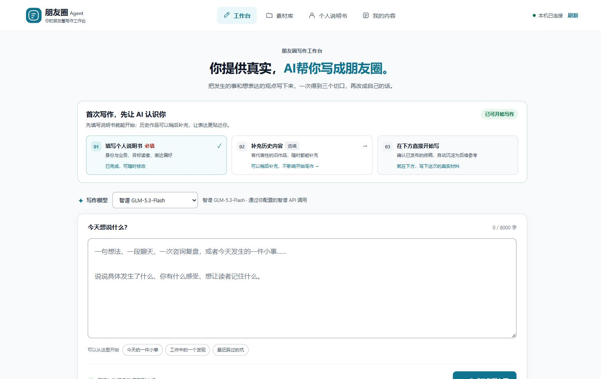

# 朋友圈 Agent

把你提供的真实材料，整理成更贴近自己表达习惯的朋友圈。

面向个人创业者、顾问和服务者。填写三项个人说明书，在工作台直接写下今天的材料，得到三个不同切口的文案；继续润色、保存终稿，由你决定是否发表。

[在线使用](https://chenxin.life/moments/) · [下载发行包](https://github.com/bcc2802/moments-agent/releases/latest) · [本地安装](docs/INSTALL.md) · [云端部署](cloudflare/README.md)

## 选择适合你的使用方式

| | 本地版 | 云端版 |
| --- | --- | --- |
| 入口 | Windows 双击 `start.cmd` | 自行部署后，通过 HTTPS 浏览器访问 |
| 写作模型 | 自己的智谱 GLM-5.3-Flash API 或 Codex CLI | 部署者配置的智谱 GLM-5.3-Flash API |
| 内容存储 | 代码目录以外的私有 Markdown 工作区 | Cloudflare D1，按访客身份隔离 |
| 需要准备 | Python 3.11／3.12／3.13，以及所选模型的账号 | Node.js 24、Cloudflare 账号、D1、Queues 和智谱 API Key |
| 适合 | 自己写作、保留本地文件，也可在 Codex 中协作 | 为自己的用户提供无需本地安装的写作工作台 |
| 开始 | [安装与启动](docs/INSTALL.md) | [独立部署与运维](cloudflare/README.md) |

下载的源码不附送模型额度、账号或密钥。[在线站点](https://chenxin.life/moments/)由维护者单独运营，当前体验限额为每访客每日5次、每IP20次、全站100次，生成与润色共用；站点可用性和额度以页面提示为准。自行部署使用你自己的资源与额度。

## 一条朋友圈怎样完成

1. **填写个人说明书。** 只保留三项红字“必填”：我的身份与业务、我想写给谁、我希望怎样表达。
2. **直接开始写。** 在首页工作台输入真实材料、观点或经历；历史作品选填，没有历史也可以生成。
3. **比较三个切口。** 用明显的标题与视觉标记区分“讲过程、说判断、代入读者场景”，原稿号不重排。
4. **让 AI 改一改。** 选择“更口语化、更真实、更专业”，也可补充要求。预设保留事实与不确定性，不补造案例、业绩或对话。
5. **保存与手动发表。** 可以复制、保存终稿或明确保留待发；实际发表由你完成，工具不操作微信。
6. **确认已发后进入素材库。** 只有你明确确认已发、且当前正文与确认时的指纹一致的最终稿，才成为后续参考。选稿、复制、改稿、未发终稿和保留稿都不会自动入库。

生成或润色期间，全局悬浮状态显示实际阶段、目标稿件和已用时；切换导航仍可看见，并防止重复提交。状态不展示模型推理内容或虚构百分比。模型失败不会自动换服务或重复付费请求。

下图为本地工作台的合成资料截图，用于展示界面布局：

## 本地版快速开始

完整解压发行包，准备 Python 3.11／3.12／3.13，在根目录双击 `start.cmd`。默认私有工作区为用户目录下的 `MomentsAgent`，代码升级不覆盖其中的内容；启动窗口需要保持运行。

选择一种模型配置即可：

- **智谱：** 按[安装指南](docs/INSTALL.md)把自己的密钥保存在代码目录之外，仅在私有配置中填写密钥文件路径；不需要安装 Codex 或模型 SDK。
- **Codex：** 准备已登录的原生 Codex CLI ≥0.165.0，按安装指南检查模型权限与版本。仅安装桌面 App 或登录网页不代表 CLI 已可调用。

保存个人说明书后即可在首页生成三稿。[完整首轮教程](docs/QUICKSTART.md)包含素材导入、改稿、保留与已发确认。停止本机服务时，在启动窗口按 `Ctrl+C`，再次启动会读取原工作区。

在 Codex 中打开项目，也可通过仓库内 Skill 使用自然语言协作。Skill负责理解材料和流程，Python维护存档与恢复；仅运行存储脚本不会生成文案。

## 云端版怎样部署

`cloudflare/` 是独立 Worker 项目，不依赖维护者的个人网站、Astro 或本机服务。它保留 `/moments/` 路径，使用独立数据库和队列，并在服务端保存模型密钥。按[云端教程](cloudflare/README.md)创建资源、配置 Secrets、初始化数据库并部署。

访客身份由30天签名 Cookie 保存，数据按访客隔离；当前没有账号登录或跨设备恢复，清理 Cookie 或换浏览器后不能自动找回原工作区。重要正文请另行保存。默认每日限额为访客5次、IP20次、全站100次，部署者可调整。

## 数据和能力边界

个人说明书决定“像谁写”，当次材料决定“写什么”。导入历史与已发终稿用于按需检索参考，不是训练或微调基础模型。历史中的经历不能被当成这次真实发生的事实。

本地版以私有工作区中的 Markdown 为正文事实源；云端版以 D1 为事实源。材料交给云端模型时仍适用所用服务的数据规则。不要提交密钥、真实稿件、客户资料或整个工作区到 GitHub。[隐私说明](docs/PRIVACY.md) · [历史库说明](docs/HISTORY.md)

热点、配图与飞书属于本地版的可选扩展，需要另外配置和验收。基础写作不依赖它们；云端首版聚焦写作、改稿和存档。[热点渠道与扩源](docs/HOT_SOURCES.md) · [可选功能](docs/OPTIONAL_FEATURES.md)

## 文档、反馈与许可

- [填写个人说明书](docs/PERSONALIZATION.md) · [故障排查](docs/TROUBLESHOOTING.md)
- [验证记录与已知限制](docs/VALIDATION.md) · [独立试用步骤](docs/TRYOUT.md)
- [参与贡献](CONTRIBUTING.md) · [开发者入口](docs/DEVELOPER.md) · [安全问题](SECURITY.md)
- [版本变化](CHANGELOG.md) · [发行检查](docs/RELEASE_CHECKLIST.md)

本项目自有代码、文档、模板与合成示例采用 [MIT License](LICENSE)。外部服务、依赖和平台内容适用各自条款，见[许可说明](docs/LICENSING.md)与[第三方清单](docs/THIRD_PARTY.md)。项目不承诺经营效果或收入结果。
